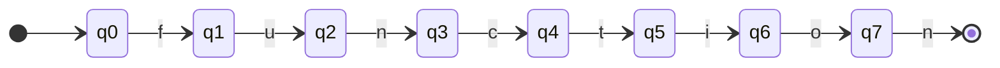

## Постановка задачи
Требуется реализовать лексический анализатор, распознающий единственный токен — ключевое слово `function`. В рамках работы необходимо:
1. Построить НКА (Томпсон) → ДКА (subset construction) → минимизированный ДКА (Хопкрофт), распознающий строку `function`.
2. Задать таблицу переходов (реализована в коде).
3. Написать функцию, возвращающую булево значение — является ли входная строка токеном `function`.
4. Написать тесты.
## Исходный ДКА
Ключевое слово `function` состоит из 8 символов: `f`, `u`, `n`, `c`, `t`, `i`, `o`, `n`.
Построение автомата выполнялось в три этапа:
1. **НКА (Томпсон)** — по регулярному выражению `function` построен недетерминированный конечный автомат методом Томпсона (последовательное соединение 8 односимвольных фрагментов).
2. **ДКА (subset construction)** — НКА детерминизирован методом подмножеств. Поскольку исходный НКА уже был «линейным» (каждое состояние имеет единственный исходящий переход), подмножества состояний оказались одноэлементными, и ДКА получился структурно идентичен НКА.
3. **Минимизированный ДКА (Хопкрофт)** — выполнена минимизация.
### Диаграмма исходного ДКА

## Таблица переходов
Таблица переходов реализована в конструкторе класса `FunctionLexer` через `HashMap<Integer, Map<Character, Integer>>`:

| Состояние | `f` | `u` | `n` | `c` | `t` | `i` | `o` |
|-----------|-----|-----|-----|-----|-----|-----|-----|
| q0        | q1  | —   | —   | —   | —   | —   | —   |
| q1        | —   | q2  | —   | —   | —   | —   | —   |
| q2        | —   | —   | q3  | —   | —   | —   | —   |
| q3        | —   | —   | —   | q4  | —   | —   | —   |
| q4        | —   | —   | —   | —   | q5  | —   | —   |
| q5        | —   | —   | —   | —   | —   | q6  | —   |
| q6        | —   | —   | —   | —   | —   | —   | q7  |
| q7        | —   | —   | F   | —   | —   | —   | —   |
| FINAL     | —   | —   | —   | —   | —   | —   | —   |
## Реализация функции распознавания
Функция `isFunctionToken()` реализует обход ДКА:
```java
private boolean isFunctionToken() throws IOException {
    int currentState = q0;
    int symbol;
    while ((symbol = reader.read()) != -1) {
        char s = (char) symbol;
        Map<Character, Integer> stateTransitions = transitions.get(currentState);

        if (stateTransitions == null || !stateTransitions.containsKey(s)) {
            break; // переход в TRAP
        }

        currentState = stateTransitions.get(s);

        if (currentState == FINAL) {
            int nextSymbol = reader.read();
            if (nextSymbol == -1) return true;
            char nextChar = (char) nextSymbol;
            if (Character.isWhitespace(nextChar)) return true;
            else return false;
        }
    }
    return false;
}
```
### Логика работы
1. Начинаем с состояния `q0`.
2. Поочерёдно читаем символы из файла и выполняем переход по таблице.
3. Если перехода нет — прерываем цикл (строка не является токеном).
4. При достижении `FINAL` дополнительно проверяем следующий символ:
   - конец файла → токен;
   - пробельный символ → токен;
   - иначе (`functionX`, `function123` и т.п.) → не токен.
5. Возвращаем `true` только при полном совпадении с `function` и корректном разделителе.
## Тестирование
Входные файлы находятся в папке: `src/test/java/`.

| Содержимое файла | Ожидаемый результат | Фактический результат |
| ---------------- | ------------------- | --------------------- |
| `function`       | токен               | токен                 |
| `function\n`      | токен               | токен                 |
| ``      | не токен            | не токен              |
| `func`           | не токен            | не токен              |
| `Function`       | не токен            | не токен              |
##  Вывод
В ходе работы:
- Построен автомат, распознающий ключевое слово `function`, в три этапа:
    1. **НКА (метод Томпсона)** — по регулярному выражению `function` построен недетерминированный конечный автомат;
    2. **ДКА (subset construction)** — НКА детерминизирован методом подмножеств; так как исходный НКА «линейный», подмножества оказались одноэлементными, и ДКА структурно совпал с НКА;
    3. **Минимизация (алгоритм Хопкрофта)** — выполнена через уточнение разбиения: начальное деление на принимающие/непринимающие состояния, последовательное уточнение классов по переходам, достижение неподвижной точки. Все состояния оказались различимыми, поэтому минимальный DFA совпал с исходным ДКА.
- Таблица переходов реализована в виде `HashMap` в классе `FunctionLexer`.
- Написана функция `isFunctionToken()`, корректно определяющая, является ли содержимое файла токеном `function`, с учётом проверки разделителя после ключевого слова.